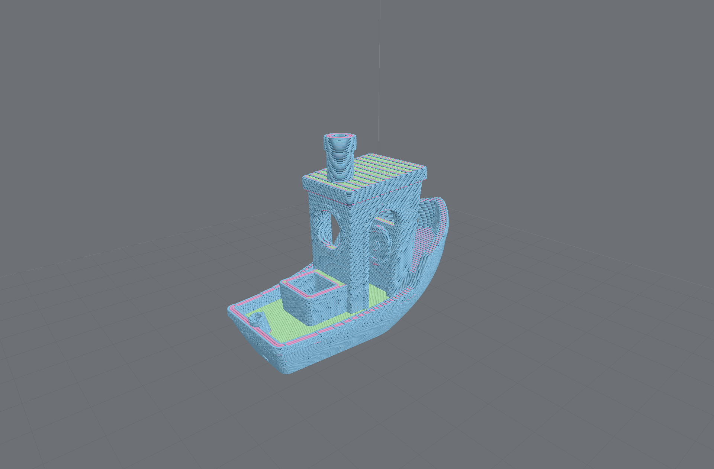
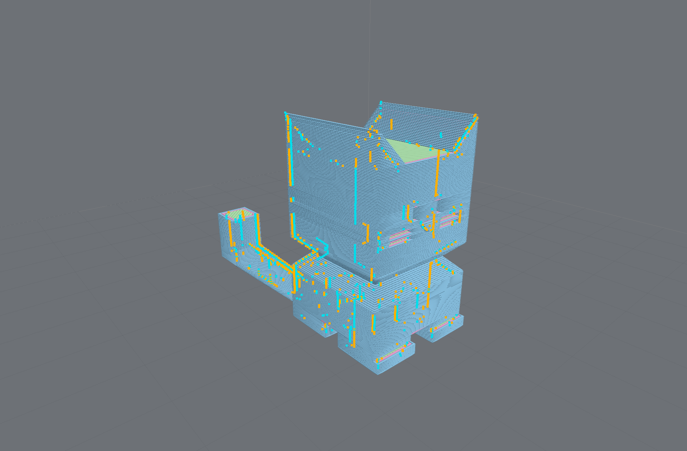

# @chestnutlabs/gcode-renderer-three

Three.js **toolpath renderer** consuming [`ToolpathIR`](../toolpath-core/README.md) for the Chestnut Labs
G-code Preview stack (design: DD-004, live-progress overlay: DD-006).

> **Peer dependency:** `three` (supported range `^0.178.0`) — install it alongside this package.



- Layer-chunked line geometry with decimation + disclosure; tube geometry with automatic
  quality fallback
- Layer-range clipping and segment-level scrub via draw ranges (no rebuilds)
- Per-file build plates (`setBuildVolume`, mismatch events, consumer-wins precedence)
- DD-006 live-progress overlay: completed cut + translucent remaining-path ghost + always-on-top
  marker (byte-exact) or uncertainty band (approximate); user scrub always wins
- Opt-in retraction/deretraction markers (`setShowRetractions`) — warm = retract, cool = unretract,
  clipped by the same layer/scrub window; capability-honest (shown only when the IR carries events)


- Time-budgeted build ticks (rAF with a timeout backstop — works when rAF is suspended or absent),
  WebGL context-loss rebuild, injectable GL backend and frame scheduler (testable & headless-shaped)

```ts
import { ToolpathRenderer } from '@chestnutlabs/gcode-renderer-three';

const renderer = new ToolpathRenderer({ canvas });
renderer.setIR(ir);           // builds progressively; 'buildComplete' event when done
renderer.setLayerRange(0, 42);
renderer.setProgress(mapped); // DD-006 MappedProgress overlay
```

## Studio look (opt-in)

`studioTheme('dark' | 'light')` returns a `Theme` (gradient backdrop, solid build plate with grid and outline,
contact shadow) and `STUDIO_CAMERA_FOV` is `32`. Both are optional: with no theme the renderer is unchanged.

```ts
import { ToolpathRenderer, studioTheme, STUDIO_CAMERA_FOV } from '@chestnutlabs/gcode-renderer-three';

const renderer = new ToolpathRenderer({ canvas, theme: studioTheme('dark'), cameraFov: STUDIO_CAMERA_FOV });
renderer.setBuildVolumeCage(false); // the preset is measured with the cage off
```

`cameraFov` accepts 10-120 degrees and throws `RangeError` outside it, and so does `lensScale(from, to)`. See the
[Studio look and build plate guide](https://github.com/ChestnutLabs/gcode-preview/blob/dev/docs/manual/guide-looks-lens-plate.md).

### Theme values that throw

A theme value the renderer can't draw throws a `RangeError` that names the field, from the `theme` option and
from `setTheme()`. Before, it drew something else without telling you. The defaults and both `studioTheme()`
presets pass.

| Field | Accepted |
| --- | --- |
| `hemisphereIntensity`, `directionalIntensity` | a finite number `>= 0` |
| `materialPreset` | `'matte'` or `'glossy'` |
| `bedSurface.mode` | `'none'` or `'solid'` (required when you pass `bedSurface`) |
| `bedSurface.opacity` | a number in `[0, 1]` |
| `bedSurface.thickness` | a finite number `>= 0` |
| grid, major-grid, outline and contact-shadow opacities | a number in `[0, 1]` |
| `gridMajor.every` | a finite number above 0 |

A misspelled `materialPreset` or `bedSurface.mode` used to fall back to matte, or to no plate. It now throws,
and the message lists the accepted values. If your theme comes from user settings or untyped JSON, check these
two fields first. `createContactShadow(footprint, opacity)` throws for an `opacity` outside `[0, 1]`. Colour
strings are not checked yet.

The model viewer (`@chestnutlabs/gcode-model-renderer`) checks the same theme the same way.

## Pixel ratio (opt-in)

`ToolpathRenderer` (and `createModelViewer`) take `pixelRatio`: a number in (0, 4], or `'device'` for
`min(devicePixelRatio, 2)`, followed live. `renderer.setPixelRatio(ratio)` changes it later. Anything else throws
`RangeError`. Unset, the renderer keeps its own ratio and never calls the GL's `setPixelRatio` at rest. `interactionQuality`
lowers the ratio while you orbit and settles back on yours. The type is `PixelRatioOption`.

```ts
const renderer = new ToolpathRenderer({ canvas, pixelRatio: 'device' });
```

An unsized `capture()` is the resting drawing-buffer size when unset and the canvas's CSS size when set, so with the
built-in renderer setting a ratio never changes the default capture size (a custom `createRenderer` already at
another ratio returns its own drawing-buffer size when unset); pass `width`/`height` for a crisper image. Ratio 2 shades four times the
fragments of ratio 1.

## Bad coordinates and bad build volumes

A segment with an `Infinity` or `NaN` endpoint coordinate is not drawn. The camera frame still comes from the IR's bounds, so with the default `frameContent: 'all'` the
camera frames the build volume (or the preview bounds) instead of the remaining toolpath; under `'object'` it
tries the model, then the object bounds, then the build volume. The 2D renderer skips on x/y only.
`buildChunks` counts skipped segments in `skippedNonFinite`, and the renderer's `buildComplete` event carries the
count. `GcodePreview` and the framework adapters report it in their `disclosure` text, for example
`4 segments with a non-finite coordinate were not drawn.` `createBuildVolume` and
`setBuildVolume` throw `RangeError` for a volume that cannot be drawn: a non-finite size, origin or height, a grid
pitch that is not a positive number, more than 10 000 grid lines on one axis, or an origin so large that the pitch
no longer advances. A bed discovered in the file (a `MachineGeometry`) never throws: `setBuildVolume` keeps the
current volume and emits an `error` event with code `machine-geometry-invalid`. A `decimation` option must be a
whole number of at least 1, or `'auto'`; anything else throws `RangeError`. The tube and budget options
are checked the same way, and `undefined` keeps the default: `tube.radialSegments` is a whole number from 3
to 64, `tube.lineWidth` and `tube.lineHeight` are finite and above 0, `tube.maxVertices` is a whole number of
at least 1, `tubeByteBudget` and `geometryMemoryBudgetBytes` are finite and above 0, `geometryConcurrency` is
`'auto'`, `'off'` or a whole number of at least 1, and `qualityMode` (and `setQualityMode()`) takes `'full'`,
`'adaptive'` or `'fast'`.

## Tighter limits on software GL

On headless or software-rendered GL (CI, a VM, a remote desktop) a large file can exhaust memory long before it is
slow. Nothing in the renderer adapts to this for you yet (`resolveCapability` and `capabilityHint` are
experimental and diagnostic-only), so read the context yourself and pick tighter limits:

```ts
import { detectRenderCapability } from '@chestnutlabs/gcode-renderer-three';

const gl = document.createElement('canvas').getContext('webgl2'); // a scratch canvas, not the one you render to
const { capability } = gl ? detectRenderCapability(gl) : { capability: 'unknown' };
const constrained = capability !== 'hardware'; // 'unknown' (extension blocked) is treated as constrained

// pass to the parse step (adapters: `parseOptions`) and, on a direct renderer, to `tubeByteBudget`
const parseOptions = constrained ? { limits: { maxSegments: 2_000_000 } } : {};
const tubeByteBudget = constrained ? 100_000_000 : undefined;
```

`detectRenderCapability` never throws; it returns `{ capability: 'unknown', rawRenderer: null }` when the browser hides the
renderer string. The two numbers above are starting points to tune for your hardware, not recommendations
from measurement.

Most applications should consume this through [`@chestnutlabs/gcode-preview-core`](../gcode-preview-core/README.md)
or a framework adapter, which own the parse→render lifecycle.

## The three-free `/lite` entry

`@chestnutlabs/gcode-renderer-three/lite` holds the pieces that never load three.js: `CaptureUnsupportedError`,
`studioTheme`, `STUDIO_CAMERA_FOV`, the option checks below, and the theme, camera and capture types. You normally don't need it: the main
entry exports the same things. It exists for packages that load the renderer on demand, like
`@chestnutlabs/gcode-preview-core`, so a 2D-only app loads no three.js. If the main entry could not load (offline, or a stale deploy) or could not start (no WebGL), core reports
`E_RENDERER_LOAD` on its `error` event, with `reason: 'load'` or `reason: 'start'`; for `'start'` (usually no WebGL), use `renderer: { mode: '2d' }`. Tests that wait a fixed number of ticks for the 3D renderer to bind can preload it
once: `await import('@chestnutlabs/gcode-renderer-three')`.

The option checks are the renderer's own rules, so you can check a value before any renderer exists (a setting a
user typed, for example). Each throws `RangeError` with the same message the renderer throws:

| Check | Accepts |
| --- | --- |
| `checkTheme(theme)` | see [theme values that throw](#theme-values-that-throw) |
| `checkBuildVolume(def)` | a volume the grid can draw: finite sizes, at most `MAX_GRID_LINES_PER_AXIS` (10 000) lines per axis |
| `checkCameraMode(mode)` | `CAMERA_MODES`: `'perspective'`, `'orthographic'` |
| `checkCameraView(view)` | `CAMERA_VIEWS`: `'top'`, `'bottom'`, `'front'`, `'back'`, `'left'`, `'right'`, `'iso'` |
| `checkCameraState(state)` | finite `position` / `target`, `zoom` > 0, a valid `cameraMode` |
| `checkCameraFov(fov)` | 10 to 120 degrees |
| `checkPixelRatio(ratio)` | `'device'`, or a number in (0, 4] |
| `checkQualityMode(mode)` | `QUALITY_POLICIES`: `'full'`, `'adaptive'`, `'fast'` |
| `checkProgressivePreview(mode)` | `PROGRESSIVE_PREVIEW_MODES`: `'auto'`, `'lines'`, `'hold'`, `'off'` |
| `checkFrameContent(mode)` | `FRAME_CONTENT_MODES`: `'object'`, `'all'` |
| `checkInteractionQuality(mode)` | `INTERACTION_QUALITY_MODES`: `'off'`, `'auto'` |
| `checkRendererMode(mode)` | `RENDERER_MODES`: `'2d'`, `'3d'` |

The upper-case lists are `readonly` arrays, so you can filter input without a `try`/`catch`:
`CAMERA_MODES.includes(value)`.

Part of [Chestnut Labs G-code Preview](../../README.md) · MIT
